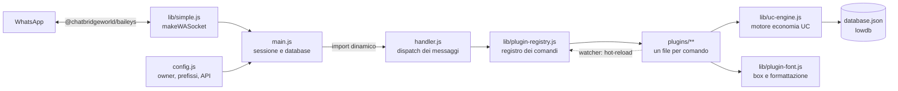

<div align="center">


<br/>

### 🌐 Per conoscere e ricevere novita visita **[chatbridge.it](https://chatbridge.it)**

<a href="https://github.com/chatbridgegit/chatbridge-bot">
  
</a>

<br/>

[](https://github.com/chatbridgegit/chatbridge-bot/stargazers)
[](https://github.com/chatbridgegit/chatbridge-bot/network/members)
[](https://github.com/chatbridgegit/chatbridge-bot/issues)
[](https://github.com/chatbridgegit/chatbridge-bot/commits)
[](#-licenza)


</div>

---

## ⭐ Supporta il progetto

Se ChatBridge ti e utile, lascia una **stellina** sul repository: e il modo piu semplice per supportare il progetto e farlo crescere. Bastano due secondi!

<div align="center">

<a href="https://github.com/chatbridgegit/chatbridge-bot">
  
</a>

<br/>

[](https://github.com/chatbridgegit/chatbridge-bot)


</div>

---

## 🧭 Indice

- [Installazione](#-installazione)
  - [Installazione normale](#-installazione-normale)
  - [Installazione con fork](#-installazione-con-fork)
- [Primo avvio e collegamento](#-primo-avvio-e-collegamento)
- [Configurazione](#-configurazione)
- [Funzionamento 24/7 con PM2](#-funzionamento-247-con-pm2)
- [Reset della sessione](#-reset-della-sessione)
- [Panoramica](#-panoramica)
- [Architettura](#-architettura)
- [Stack tecnologico](#-stack-tecnologico)
- [Statistiche](#-statistiche)
- [Comandi principali](#-comandi-principali)
- [Struttura del progetto](#-struttura-del-progetto)
- [Scrivere un plugin](#-scrivere-un-plugin)
- [Domande frequenti](#-domande-frequenti)
- [Risoluzione problemi](#-risoluzione-problemi)
- [Contribuire](#-contribuire)
- [Community](#-community)
- [Licenza](#-licenza)

---

## ⚙️ Installazione

### 📋 Requisiti

- **Node.js 20 LTS** o superiore (consigliato 22 LTS) e **npm**
- **Git**
- Un numero WhatsApp dedicato al bot (consigliato, non usare il tuo principale)
- Windows, Linux, macOS, VPS oppure Android con Termux

> FFmpeg e incluso tramite `ffmpeg-static` su Windows, Linux e macOS. Su Termux va installato con `pkg`.

### 📦 Installazione normale

Usa questa procedura se vuoi solo far girare il bot. Clona il repository originale, senza creare un fork.

#### 🖥️ Windows, Linux, macOS o VPS

```bash
git clone https://github.com/chatbridgegit/chatbridge-bot.git
cd chatbridge-bot
npm install
npm start
```

Su Windows esegui gli stessi comandi in PowerShell, dalla cartella in cui vuoi clonare il progetto.

> Con questa procedura non puoi salvare modifiche su GitHub. Se vuoi modificare il bot, usa l'[installazione con fork](#-installazione-con-fork).

#### 📱 Termux

Installa Termux da [F-Droid](https://f-droid.org/packages/com.termux/). La versione del Play Store non e piu aggiornata.

```bash
pkg update -y && pkg upgrade -y
pkg install -y git nodejs ffmpeg
termux-setup-storage
git clone https://github.com/chatbridgegit/chatbridge-bot.git
cd chatbridge-bot
npm install
npm start
```

> Se `npm install` fallisce su Termux per una dipendenza nativa (`sharp`, `canvas`), leggi l'errore completo e consulta [Risoluzione problemi](#-risoluzione-problemi).

---

### 🍴 Installazione con fork

Usa questa procedura se vuoi modificare il bot, salvare le tue modifiche su GitHub e ricevere gli aggiornamenti. Il **fork** crea una tua copia del repository su GitHub. Ti serve per modificare il bot, salvare le tue impostazioni e ricevere gli aggiornamenti.

<div align="center">

<a href="https://github.com/chatbridgegit/chatbridge-bot/fork">
  
</a>

</div>

**Come creare il fork:**

1. Accedi a GitHub. Se non hai un account, creane uno gratuito su [github.com](https://github.com).
2. Clicca il bottone **Fai il Fork** qui sopra: si apre la pagina *Create a new fork*.
3. Nel campo **Owner** scegli il tuo account.
4. Il campo **Repository name** puo restare `chatbridge-bot`.
5. Clicca **Create fork**. GitHub crea il tuo repository, ad esempio `https://github.com/TUO-USERNAME/chatbridge-bot`.

Da qui in poi sostituisci `TUO-USERNAME` con il tuo nome utente GitHub in tutti i comandi.

#### 🖥️ Windows, Linux, macOS o VPS con fork

Clona il **tuo fork** e avvia il bot:

```bash
git clone https://github.com/TUO-USERNAME/chatbridge-bot.git
cd chatbridge-bot
npm install
npm start
```

Esempio con un account chiamato `mario-rossi`:

```bash
git clone https://github.com/mario-rossi/chatbridge-bot.git
```

Su Windows esegui gli stessi comandi in PowerShell, dalla cartella in cui vuoi clonare il progetto.

**Ricevere gli aggiornamenti del progetto originale:**

```bash
# da fare una sola volta, dentro la cartella del progetto
git remote add upstream https://github.com/chatbridgegit/chatbridge-bot.git

# ogni volta che vuoi aggiornare
git fetch upstream
git merge upstream/main
```

> Se il branch principale si chiama `master` invece di `main`, usa `upstream/master`. Puoi controllarlo con `git branch`.

> Non committare la cartella `sessioni/` e il file `database.json`: contengono dati privati del bot e del tuo numero WhatsApp.

#### 📱 Termux con fork

Prima di tutto installa Termux e i pacchetti necessari (vedi [Termux](#-termux)). Poi clona il tuo fork:

```bash
git clone https://github.com/TUO-USERNAME/chatbridge-bot.git   # sostituisci TUO-USERNAME con il tuo nome utente
cd chatbridge-bot
npm install
npm start
```

---

## 🔗 Primo avvio e collegamento

Al primo avvio il bot chiede come collegare WhatsApp:

```
╭━━〔 SCELTA CONNESSIONE 〕━━⬣
┃ 1. QR Code
┃ 2. Pairing Code
╰━━━━━━━━━━━━━━━━━━━━⬣
➤ Inserisci 1 o 2:
```

| Metodo | Come si usa |
|---|---|
| **1. QR Code** | Scansiona il QR nel terminale da *WhatsApp > Dispositivi collegati > Collega un dispositivo* |
| **2. Pairing Code** | Inserisci il numero del bot con prefisso internazionale, senza simboli (es. `393471234567`), poi digita il codice mostrato su WhatsApp |

Quando compare `Collegato con successo`, il bot e online. La sessione viene salvata nella cartella `sessioni/`, quindi ai riavvii successivi non serve ricollegarsi.

---

## 🛠️ Configurazione

### Owner, prefissi e impostazioni base

Le impostazioni principali sono in [`config.js`](./config.js):

```js
// Owner: [numero senza +, nome, permesso]
global.owner = [
  ['393xxxxxxxxx', 'NomeOwner', true],
]

global.maxwarn = 4          // numero di warn prima dell'azione automatica
global.inactiveDays = 30    // giorni senza attivita per considerare un membro inattivo
```

Il prefisso predefinito dei comandi e il punto (`.`). Altri simboli accettati sono definiti in `global.prefix` dentro `config.js`.

### Variabili d'ambiente (opzionali)

| Variabile | Default | Uso |
|---|---|---|
| `BOT_VERSION` | versione in `package.json` | Versione mostrata nel menu |
| `CHATUNITY_API_KEY` | vuota | Chiave API per il comando di download `.play` |
| `LASTFM_API_KEY` | chiave incorporata | Chiave Last.fm per i comandi musicali |

Esempio su Linux, macOS o Termux:

```bash
BOT_VERSION=14.1 npm start
```

Esempio su Windows PowerShell:

```powershell
$env:CHATUNITY_API_KEY = "la-tua-chiave"; npm start
```

> Il nome `CHATUNITY_API_KEY` e mantenuto per compatibilita con le installazioni esistenti.

---

## 🔁 Funzionamento 24/7 con PM2

PM2 mantiene il bot attivo e lo riavvia in caso di crash.

```bash
npm install -g pm2
pm2 start main.js --name chatbridge
pm2 save
pm2 logs chatbridge
```

Comandi utili: `pm2 restart chatbridge`, `pm2 stop chatbridge`, `pm2 status`.

---

## 🧹 Reset della sessione

Per ricollegare il bot da zero (dovrai scansionare di nuovo il QR o inserire un nuovo pairing code):

```bash
# Linux, macOS, Termux
rm -rf sessioni

# Windows PowerShell
Remove-Item -Recurse -Force sessioni
```

---

## 🌉 Panoramica

**ChatBridge** e un bot WhatsApp multifunzione costruito su Node.js e `@chatbridgeworld/baileys`. Ogni comando e un plugin separato: puoi aggiungerne, modificarne o rimuoverne uno senza toccare il core, e le modifiche si applicano a caldo.

| | Area | Cosa include |
|---|---|---|
| 💠 | **Economia UC** | Lavori, banca, investimenti, case, auto, missioni, eventi, bonus e classifiche |
| 🎮 | **Giochi** | Slot, dadi, duello, trivia, wordle, anagrammi, tornei e altri minigiochi |
| 🛡️ | **Protezioni** | Anti-link, anti-spam, anti-flood, anti-virus, anti-porno, anti-tiktok e altri filtri |
| 👥 | **Gruppi** | Warn, mute, ban parole, promozioni, tag, hidetag, sondaggi, regole e moderazione |
| 🛠️ | **Strumenti** | Download, sticker, traduttore, meteo, calcolatrice, QR code, promemoria |
| 🔌 | **Plugin** | Caricamento automatico, registro dei comandi e hot-reload |

---

## 🏗️ Architettura

Il flusso di un messaggio, dal numero WhatsApp fino alla risposta:



---

## 🧰 Stack tecnologico

<p>
  
</p>

<p>
  
  
  
  
  
</p>

---

## 📊 Statistiche

<div align="center">


<br/>


<br/><br/>


</div>

> Le card per utente mostrano i dati dell'account `chatbridgegit`. Se questo nome e un'organizzazione, le card utente non funzionano e vanno usate quelle di un account personale.

| Dato del progetto | Valore |
|---|---|
| File plugin | 209 |
| Moduli core in `lib/` | 22 |
| Categorie di plugin | 10 |
| Dipendenze principali | Baileys, lowdb, Sharp, FFmpeg (via `ffmpeg-static`) |

---

## 📜 Comandi principali

I comandi iniziano con il prefisso `.`. Il menu principale mostra le sezioni disponibili in base al tuo ruolo.

| Comando | Descrizione |
|---|---|
| `.menu` | Menu principale |
| `.menu-divertimento` | Giochi e comandi divertenti (anche `.menu-gruppo`) |
| `.menu-tools` | Strumenti: download, sticker, meteo, traduttore, QR e altro |
| `.menueconomia` | Economia e giochi con UC |
| `.menuprotezioni` | Protezioni e automazioni dei gruppi |
| `.menu-adminmod` | Comandi per amministratori e moderatori |
| `.ping` | Uptime e latenza reale |
| `.profilo` | Profilo, XP e portafoglio |
| `.topcmd` | Top 10 dei comandi usati |
| `.owner` | Contatti degli owner |

---

## 🗂️ Struttura del progetto

```
chatbridge-bot/
├── main.js              # Entry point: connessione, sessione, database, watcher
├── handler.js           # Gestione messaggi e dispatch dei comandi
├── config.js            # Configurazione globale: owner, nome, prefissi, API
├── package.json
├── lib/                 # Core: socket WhatsApp, store, code, motore economia, UI
├── media/               # Immagini, GIF e file multimediali usati dal bot
└── plugins/             # Un file per comando, divisi per area
    ├── menu-*.js        # Menu principali
    ├── @beta/           # Funzioni in test
    ├── economy/         # Lavori, banca, investimenti, proprieta
    ├── fun/             # Comandi di intrattenimento
    ├── games/           # Minigiochi
    ├── group/           # Gestione gruppi
    ├── funzioni/        # Protezioni e automazioni
    ├── info/            # Info, profilo, ping
    ├── owner/           # Comandi riservati al proprietario del bot
    ├── tools/           # Strumenti e download
    └── world/           # Mondo di gioco: case, auto, eventi, missioni
```

---

## 🧩 Scrivere un plugin

Ogni file in `plugins/` esporta un plugin. Esempio minimo:

```js
// plugins/tools/tools-hello.js
import { definePlugin } from '../../lib/plugin-utils.js'

async function hello(m, { command }) {
  return m.reply(`Ciao! Hai usato ${command}.`)
}

export default definePlugin(hello, {
  name: 'tools-hello',
  command: ['hello', 'ciao'],   // alias del comando, con prefisso .
  category: 'tools',
  description: 'Saluta chi usa il comando',
  icon: '👋',
  order: 99,
})
```

I plugin vengono caricati all'avvio e ricaricati automaticamente quando il file cambia.

---

## ❓ Domande frequenti

<details>
<summary><b>Perche le card GitHub non si aggiornano subito?</b></summary>

Le immagini sono salvate in cache, quindi i dati possono restare vecchi per qualche ora. Le card su un servizio pubblico possono anche essere limitate durante i picchi di traffico.

</details>

<details>
<summary><b>Posso usare il bot in un gruppo?</b></summary>

Si. Il bot deve essere amministratore del gruppo per le azioni che lo richiedono, come eliminare messaggi o rimuovere membri.

</details>

<details>
<summary><b>Dove sono salvati i dati degli utenti?</b></summary>

Nel file `database.json` nella cartella del progetto, gestito con lowdb. Fai una copia di backup prima di aggiornare il bot.

</details>

---

## 🆘 Risoluzione problemi

<details>
<summary><b>Il QR non compare o il collegamento fallisce</b></summary>

- Scegli il metodo corretto (1 o 2) al primo avvio.
- Se la sessione e danneggiata, segui la procedura di [reset della sessione](#-reset-della-sessione).
- Il pairing code scade in fretta: se non lo inserisci in tempo, riavvia il bot per riceverne uno nuovo.

</details>

<details>
<summary><b>Errore durante <code>npm install</code> (sharp, canvas)</b></summary>

- Usa Node.js 20 LTS o superiore.
- **Windows:** installa i *Build Tools per C++* di Visual Studio.
- **Linux:** installa le librerie di sistema richieste da `canvas` (cairo, pango).
- **Termux:** se una dipendenza nativa non si compila, aggiorna i pacchetti con `pkg upgrade` e controlla l'errore completo.

</details>

<details>
<summary><b>I comandi non rispondono</b></summary>

- Controlla che nel terminale compaia `Collegato con successo`.
- Verifica il prefisso (`.`) e che il tuo numero abbia il ruolo richiesto (owner, admin o moderatore) per il comando.

</details>

<details>
<summary><b>Il comando <code>.play</code> non funziona</b></summary>

- Imposta la variabile `CHATUNITY_API_KEY` con una chiave valida prima di avviare il bot.

</details>

---

## 🤝 Contribuire

I contributi sono benvenuti.

1. Fai un fork del progetto
2. Crea un branch: `git checkout -b feature/nome-feature`
3. Controlla lo stile del codice: `npm run eslint`
4. Committa e pusha: `git commit -m "feat: descrizione"` poi `git push origin feature/nome-feature`
5. Apri una Pull Request

Per segnalare bug o proporre funzioni apri una [issue](https://github.com/chatbridgegit/chatbridge-bot/issues).

<a href="https://github.com/chatbridgegit/chatbridge-bot/graphs/contributors">
  
</a>

---

## 🌐 Community

- **Repository:** [github.com/chatbridgegit/chatbridge-bot](https://github.com/chatbridgegit/chatbridge-bot)
- **Canale WhatsApp:** [unisciti qui](https://whatsapp.com/channel/0029VaZVlJZHwXb8naJBQN0J)
- **Collaborazioni:** [partecipa qui](https://whatsapp.com/channel/0029Vb1C4od5vKA35u1Mqc06)
- **Contatto:** [scrivi qui](https://wa.me/393515533859)

---

## 📄 Licenza

Il progetto e distribuito con licenza **GPL-3.0-or-later**, come indicato in `package.json`.

---

<div align="center">


**Se il progetto ti e utile, lascia una stella su GitHub**

</div>
